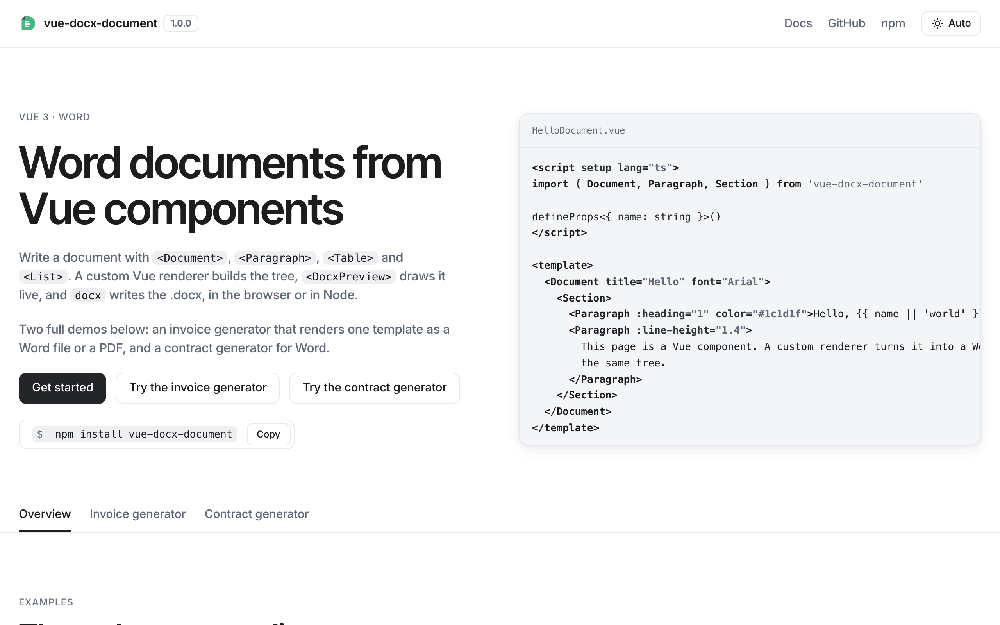
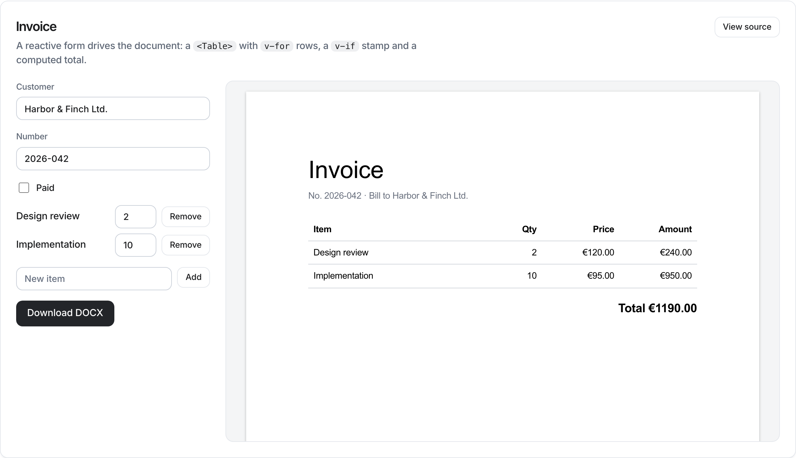
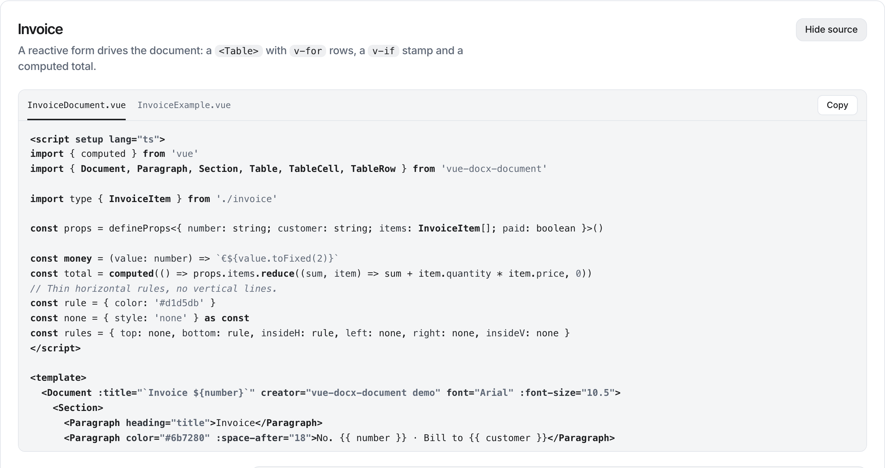
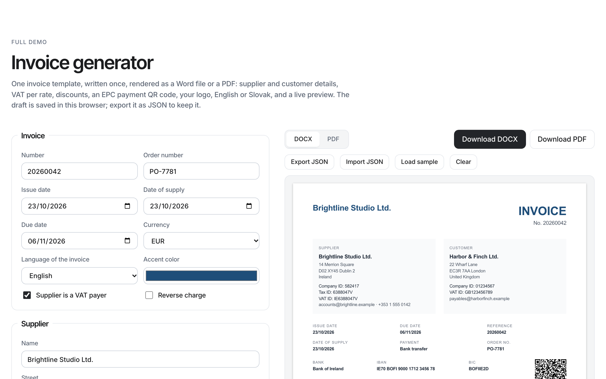
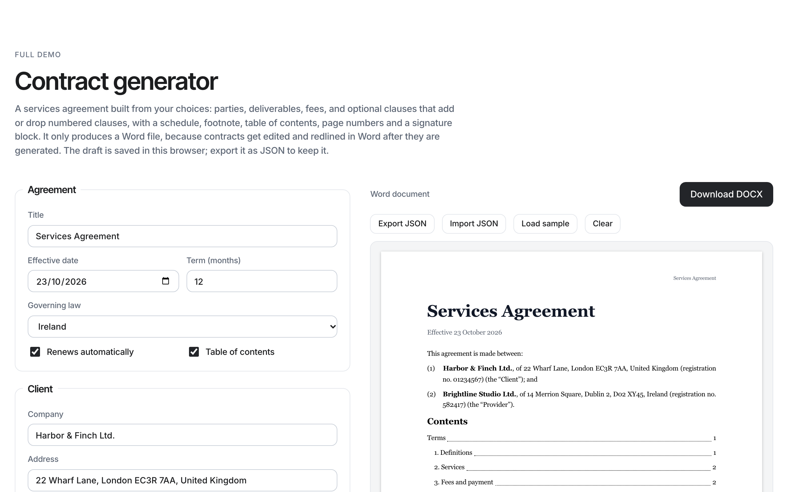

<p align="center"></p>

# vue-docx-document

[](https://www.npmjs.com/package/vue-docx-document) [](https://github.com/jantursky/vue-docx-document/actions/workflows/ci.yml) [](https://www.npmjs.com/package/vue-docx-document) [](https://github.com/jantursky/vue-docx-document/blob/main/LICENSE) [](https://codecov.io/gh/jantursky/vue-docx-document)

[Docs](https://vue-docx-document-docs.vercel.app) · [Demo](https://vue-docx-document.vercel.app) · [npm](https://www.npmjs.com/package/vue-docx-document) · [Changelog](packages/vue-docx-document/CHANGELOG.md)

Create Word (.docx) files with Vue 3 components. This repository holds the library, a demo app and the docs site.

[](https://vue-docx-document.vercel.app)

## Screenshots

A document component and the page that drives it. The form edits reactive data, the preview redraws, and **Download DOCX** writes the Word file:



The component behind it is a regular Vue single-file component built from `<Document>`, `<Section>`, `<Paragraph>` and `<Table>`:



| [Invoice generator](https://vue-docx-document.vercel.app/#generator)                                                                               | [Contract generator](https://vue-docx-document.vercel.app/#contract)                                                                                                 |
| -------------------------------------------------------------------------------------------------------------------------------------------------- | -------------------------------------------------------------------------------------------------------------------------------------------------------------------- |
|  |  |

| folder                       | what it is                                                                                        |
| ---------------------------- | ------------------------------------------------------------------------------------------------- |
| `packages/vue-docx-document` | The library, published to npm. Its [README](packages/vue-docx-document/README.md) covers the API. |
| `apps/example`               | The demo app: examples with their source, and an invoice generator on its own tab.                |
| `apps/docs`                  | The docs site, built with [Blume](https://www.npmjs.com/package/blume).                           |
| `design`                     | The design system the demo and the docs share: `DESIGN.md` and the CSS tokens.                    |

## One invoice, two formats

The demo's second tab ([`#generator`](https://vue-docx-document.vercel.app/#generator)) is an invoice tool whose template, `apps/example/src/invoice/InvoiceTemplate.vue`, is written once and exported both as DOCX (with this library) and as PDF (with [vue-pdf-document](https://www.npmjs.com/package/vue-pdf-document)).

The template doesn't import either library. It renders a small kit of layout components (`Columns`, `Line`, `ItemsTable`, `PageFooter`…) that it gets through `provide`/`inject`. The kit has two implementations with the same typed props: `kit/docx.ts` maps them onto `<Table>`, `<Paragraph>` and `<Footer>`, and `kit/pdf.ts` onto `<View>` and `<Text>`. Switch the preview between DOCX and PDF and the same data comes out in both.

The generator also has supplier and customer details, line items with discounts and VAT rates, a VAT recap, an EPC payment QR code, a logo upload, English and Slovak labels, a draft saved in `localStorage`, and JSON export and import.

## How it works

[docx](https://github.com/dolanmiu/docx) builds Word files from a tree of objects (`new Document`, `new Paragraph`, `new TextRun`…). This library builds that tree from Vue components:

1. `createRenderer` from Vue builds and patches a plain node tree as the template renders (`src/core/renderer.ts`, `src/core/nodes.ts`).
2. Before each export, a clean copy of the tree is made, without Vue's comment nodes (`src/core/snapshot.ts`).
3. The copy is resolved into a typed model: lengths in points, colors normalized, run formatting cascaded from tables down to runs, loose text wrapped in paragraphs, lists numbered, footnotes counted and images loaded and sized (`src/core/resolve.ts`, `src/core/images.ts`).
4. The model becomes `docx` objects, and `Packer` writes the file (`src/core/write.ts`). `docx` is imported on the first export only.
5. `<DocxPreview>` draws the same model as HTML pages, measures the blocks in the browser and paginates them, splitting tables between rows (`src/preview/`). It never loads `docx`.

A change to data the document reads patches the tree, and `useDocx()` or the preview renders again after a debounce.

### Prior art

Checked on 2026-10-23, before starting:

| project                                                                                                                              | approach                                       | state                                                                                 |
| ------------------------------------------------------------------------------------------------------------------------------------ | ---------------------------------------------- | ------------------------------------------------------------------------------------- |
| [`docx`](https://github.com/dolanmiu/docx)                                                                                           | Imperative object API for building .docx files | Very active: 9.14.0 published the day this repo started. This library is built on it. |
| [`react-docx`](https://github.com/Jeday/react-docx)                                                                                  | React reconciler over `docx`                   | Unmaintained: 1.0.1 from May 2022, React only.                                        |
| [`@vue-office/docx`](https://www.npmjs.com/package/@vue-office/docx)                                                                 | Vue viewer for existing .docx files            | Displays files, doesn't create them. Last release December 2024.                      |
| [`@arcships/vue-docx`](https://www.npmjs.com/package/@arcships/vue-docx)                                                             | Vue viewer and editor                          | Edits documents in the browser; not a generator.                                      |
| [`@syncfusion/ej2-vue-documenteditor`](https://www.npmjs.com/package/@syncfusion/ej2-vue-documenteditor)                             | Commercial editor component                    | Paid license, a full word processor UI.                                               |
| [`docx-templates`](https://www.npmjs.com/package/docx-templates), [`easy-template-x`](https://www.npmjs.com/package/easy-template-x) | Fill placeholders in a .docx made in Word      | A different model: the layout lives in a Word file, not in code.                      |

Before this, a Vue app that wanted to generate a Word file either wrote `docx` calls by hand or kept a template in Word. This library lets the document live next to the rest of the UI, as components.

## Requirements

- [Bun](https://bun.sh) 1.3 or newer, for installing and running scripts.
- Node.js 22.19 or newer. Vitest's coverage and the docs build run on it, and `bun run` hands those tools to Node.

## Commands

Run these from the repository root.

```sh
bun install            # install every workspace
bun run dev            # demo app with hot reload, reading the library's source
bun run dev:docs       # docs site with hot reload
bun run build          # library with size-limit budgets, then the demo app
bun run build:docs     # library, then the docs site
bun run check          # samples, format check, lint, typecheck, tests with coverage
bun run test:browser   # export and preview in real Chromium, Firefox and WebKit
bun run test:e2e       # build the demo and drive it with Playwright in all three engines
bun run lint:package   # publint and type resolution (after build)
bun run test:pack      # install the packed tarball into an empty project and render from it (after build)
bun run sync:samples   # copy the README and docs code samples into the demo, where they're type-checked
bun run format         # format everything with Prettier
bun run lint:fix       # fix what ESLint can fix
```

`bun run build` ends with [size-limit](https://github.com/ai/size-limit) and fails if the library's own code grows past 22 kB minified and gzipped, or if the library together with `docx` passes 300 kB (it's about 155 kB today). The budgets are in `packages/vue-docx-document/.size-limit.json`, and `.github/workflows/size.yml` comments the change on every pull request. Coverage goes to [Codecov](https://codecov.io/gh/jantursky/vue-docx-document) from CI, and `bun run check` fails if it drops below the thresholds in `vitest.config.ts`.

Tests come in seven layers:

- **Unit** (`packages/vue-docx-document/test`, Vitest + happy-dom): the renderer, the resolver, the writer, the preview's pagination, the components and the composables. Writer tests unzip the generated file and check `word/document.xml`, `styles.xml`, `numbering.xml`, footnotes, headers, footers and media.
- **Types** (`test/types.test.ts`): `expectTypeOf` and `@ts-expect-error` assertions that `bun run typecheck` enforces.
- **Browser** (`test/browser`): Blob output, image loading and preview pagination in Chromium, Firefox and WebKit.
- **End-to-end** (`apps/example/e2e`, Playwright): the built demo, with live previews, downloads checked by unzipping them, and the invoice generator's totals, language, QR code, logo, saved draft, JSON import and PDF export.
- **Accessibility** (`apps/example/e2e/a11y.spec.ts`, axe-core): the demo against WCAG 2.2 A and AA, in the light and dark themes.
- **Vue versions** (CI): the library's typecheck and unit tests against Vue 3.5.0, the oldest version its peer range allows, and the newest one on npm.
- **Package** (`scripts/pack-test.js`): the tarball installed into an empty project, imported and required from plain Node, rendering a real file.

The code samples in the package README and the getting-started page are copied into `apps/example/src/typecheck` by `bun run sync:samples` and compiled with the demo; `bun run check` fails if a copy is stale.

CI (`.github/workflows/ci.yml`) runs all of it, plus `build`, `lint:package` and `build:docs`, on pushes to `main` and on pull requests.

The browser tests need Playwright's engines once per machine: `bunx playwright install chromium firefox webkit`.

## Releasing a new version

1. Move the entries under `## [Unreleased]` in `packages/vue-docx-document/CHANGELOG.md` into a new section, such as `## [1.1.0] - 2026-11-03`, and add its link at the bottom. Leave an empty `## [Unreleased]` section above it.
2. Set the same version in `packages/vue-docx-document/package.json`. The demo app and the docs read it from there.
3. Run `bun run check && bun run build:docs`, commit, and push.
4. Tag the commit and push the tag:

   ```sh
   git tag v1.1.0
   git push origin v1.1.0
   ```

   `.github/workflows/release.yml` checks that the tag matches the version, runs every test suite, publishes to npm with [provenance](https://docs.npmjs.com/generating-provenance-statements), and creates a GitHub release from the changelog section.

The workflow publishes through npm's [trusted publishing](https://docs.npmjs.com/trusted-publishers), so no token is stored in the repository. Set it up once on npmjs.com under the package's **Settings → Trusted publisher**: GitHub Actions, repository `jantursky/vue-docx-document`, workflow `release.yml`, environment `npm`. The very first version has to be published by hand, since the package must exist before a trusted publisher can be added.

To publish by hand instead, run from the package folder. `prepublishOnly` runs the typecheck, both test suites, the build, the package checks and the tarball test first, and stops the publish if any fail:

```sh
cd packages/vue-docx-document
bun publish --access public
```

Versions follow semantic versioning: a breaking change needs a new major version, listed under **Changed** in the changelog.

## Deploying to Vercel

The demo app and the docs deploy as two separate Vercel projects from the same repository. Both build the library from source first, so neither depends on a published npm version.

### Demo app

1. In Vercel, choose **Add New → Project** and import the repository.
2. Leave **Root Directory** at the repository root.
3. Leave the build settings alone. `vercel.json` at the root sets them:
   - install: `bun install --frozen-lockfile`
   - build: `bun run build`
   - output: `apps/example/dist`
4. Under **Settings → Build and Deployment**, set **Node.js Version** to 22.x.
5. Deploy.

### Docs site

1. Import the same repository again as a second project.
2. Set **Root Directory** to `apps/docs`.
3. Keep **Include source files outside of the Root Directory in the Build Step** turned on (it's the default). The build needs the library and the demo's example files.
4. Leave the build settings alone. `apps/docs/vercel.json` sets them:
   - install: `bun install --frozen-lockfile`, run from the repository root
   - build: `bun run build:docs`, run from the repository root
   - output: `dist`
5. Set **Node.js Version** to 22.x, as for the demo app.
6. Deploy.

After the first setup, every push to `main` deploys to production and every pull request gets a preview URL.

## Contributing

See [CONTRIBUTING.md](CONTRIBUTING.md). Security issues go through [SECURITY.md](SECURITY.md), and everyone involved follows the [code of conduct](CODE_OF_CONDUCT.md).

## License

MIT. Word files are written by [docx](https://github.com/dolanmiu/docx) (MIT).
